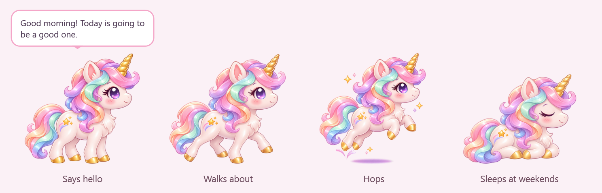
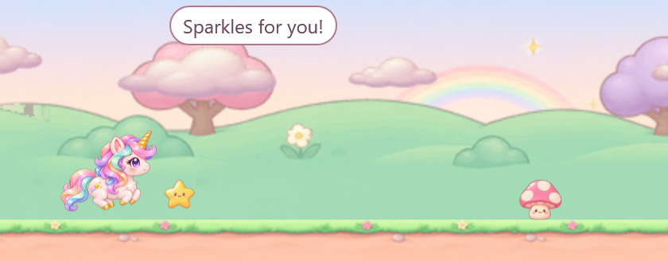
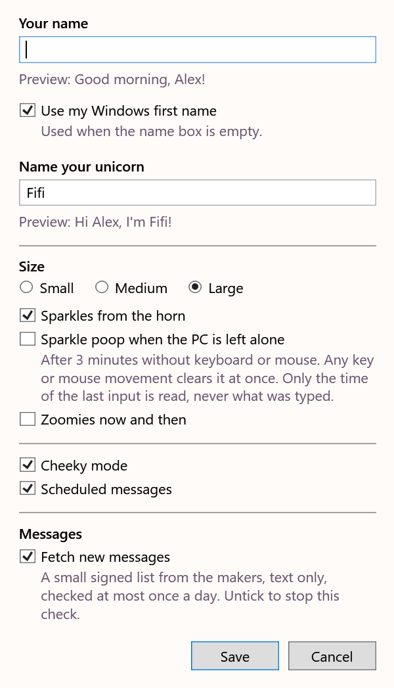

# Unicorn Pet

A small animated unicorn that lives on your Windows desktop. It wanders along the bottom of the screen, says encouraging
(and mildly cheeky) things through the working day, and has a mini game tucked inside. Made as a gift for my girlfriend.



**[Download the latest release](https://github.com/dann89/unicorn-pet-releases/releases/latest)**, unzip it and run
`UnicornPet.exe`. No installer, no admin rights, no accounts, no telemetry. The exe is not code-signed, so Windows or your
security software may warn about it.

## Features

**Company through the day**

- Walks along the bottom of the screen, hops, rests and sleeps. Drag it wherever you like.
- Greets you when it starts, with scheduled lines at 08:00, 12:45, 14:00, 16:50 and 17:00 and a random one every so often.
- Double-click it to hear something now.
- Sleeps at weekends and stays quiet outside working hours.
- Never takes the keyboard focus from what you are typing in.

**Make it yours**

- Name the unicorn (it is Fifi until you change it) and choose what it calls you.
- Three sizes, and sparkles from the horn.
- Cheeky mode for office humour, on or off.
- Message sections you can tick or untick: office banter, pep talks, unicorn facts, random facts and office roasts.
- Your own messages, from a `.json` file or an https address. Start from [the sample](docs/examples/messages.sample.json).
- Quiet for an hour or until tomorrow, or send it to sleep.

**Fun**

- **Mini game:** a little side-scrolling runner. Jump the mushrooms, duck the clouds, collect stars and beat your best score.
- **Zoomies:** a dash across all your screens, from the menu or now and then.
- **Sparkle poop:** leave the PC alone for three minutes and it makes a glittery mess that vanishes the moment you return.
  Off unless you turn it on.



## Using it

Right-click the unicorn, or its tray icon, for the menu. Everything else is in **Settings**:



To start it with Windows, press Win+R, type `shell:startup`, press Enter and put the exe, or a shortcut to it, in that folder.

## What it touches

- **Files:** only `%APPDATA%\UnicornPet` (settings, and any message lists it has downloaded).
- **Network:** "Fetch new messages" checks this project's releases at most once a day for a signed, text-only list. It is on
  by default; untick it in Settings to stop. If you point it at your own web address, it also reads that once a day.
- **Your name:** with "Use my Windows first name" ticked it asks Windows for your display name. On a domain PC, Windows may
  contact the domain controller to answer.
- It never installs or copies itself, writes to the registry, starts other programs or downloads code. A build check
  (`tools/check-worksafe.ps1`) fails the package if the exe starts to.

## Building

Needs the .NET SDK (built with 10.0) on Windows. The app targets .NET Framework 4.8.

```powershell
dotnet build -c Release
```

```powershell
dotnet test -c Release
```

```powershell
.\tools\package-worksafe.ps1 -Version 2.1.2
```

The shipped program is `src/UnicornPet.WorkSafe`. An earlier self-updating build in `src/UnicornPet.App` is kept for
reference; the two share most of their source. More detail is in the [development notes](docs/DEVELOPMENT.md).

The release signing key is not part of this repository. To publish your own message lists or updates, create your own key
as described there.

## Artwork

The unicorn and game artwork was AI-generated for this project.
